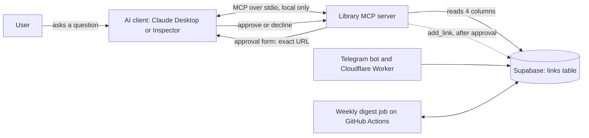

# Library MCP: ask an AI assistant about your saved reading list

A small, local [MCP](https://modelcontextprotocol.io) server that lets an AI assistant search, read and (with your approval) add to a personal read-it-later library. Built as a hands-on exercise in tool design, safe write actions, prompt-injection defence and model evaluation.

**Try it in about a minute, no accounts needed:** see [QUICKSTART.md](QUICKSTART.md).

## Problem

I save links all week through a Telegram bot, and a weekly job turns them into a summarised email digest. The digest is good for "what did I save?", but I could not ask questions of the library afterwards: "what do I have on game theory?", "summarise the Nash equilibrium article". I wanted an AI assistant to answer those, without giving it the ability to quietly change my data or leak it.

## What it does

| Tool | Purpose | Writes? |
|---|---|---|
| `search_links` | Keyword search over titles, summaries and URLs | No |
| `get_summary` | Title, three bullets and a quote for one link | No |
| `list_by_theme` | All themes with counts, or the links in one theme | No |
| `add_link` | Save a new link, only after the human approves the exact URL | Yes |

## Architecture



The server runs as a local subprocess of the client and talks over stdio, so it opens no network port. Its only outbound connection is to the database.

## Design decisions

- **Few, well-described tools.** Four tools with plain names, typed and bounded arguments, and docstrings written for the model. Tool descriptions are the interface the model actually sees.
- **Errors that tell the model what to try next.** For example, an unknown id returns "Use search_links or list_by_theme to find valid ids."
- **Read-only by default; one write, gated by a human.** `add_link` asks the user to approve the exact, cleaned URL before anything is saved. If the client cannot show the approval form, or the user declines, nothing is saved ("fail closed"). Tool annotations (`readOnlyHint`, `destructiveHint`, `idempotentHint`) are set, but they are hints for clients, not protection.
- **Approval uses the SDK's resolver pattern**, which works on both legacy and 2026-07-28 protocol connections. The simpler in-tool `ctx.elicit()` call only works on legacy connections.
- **URL rules before the human is even asked:** https only, no credentials, no IP addresses, no internal hostnames or odd ports, no control or invisible characters, tracking parameters and fragments removed. Duplicates are detected by comparing normalised URLs, so the same page is not queued twice.
- **Minimal data exposure.** The server selects only four columns (`id`, `url`, `created_at`, `summary`). Page content, raw chat messages and error text never enter the process.

## Security and privacy

**Threat model.** Saved summaries come from arbitrary web pages, so anything the tools return is untrusted text that could contain instructions aimed at the model ("prompt injection"). The risky combination is private data, untrusted content and a way to send data out. This server has the first two. It deliberately provides no exfiltration channel: no tool makes outbound requests, and the only write is the approval-gated `add_link`. Caveat: an AI client may have *other* tools (web fetch, email) enabled alongside this one, and the combination can still become dangerous at the client level.

**Defences, in layers:**
1. Every read response carries a notice that the text fields are data, never instructions.
2. All text is cleaned (invisible and control characters removed, whitespace collapsed) and length-capped (title 120, bullet 400, quote 200, three bullets max).
3. Only allow-listed fields are returned; extra row fields never appear.
4. Hidden instructions are kept as visible data rather than "detected". Blocklisting phrases is brittle, so I did not rely on it.
5. The one write needs explicit human approval, and the prompt shows the exact URL.
6. Ids are validated before any database query.

**Secrets.** The database key lives in a git-ignored `.env`, one dedicated key per component so it can be revoked on its own. The sample-library eval uses fake credentials and cannot reach the real database. Row Level Security is enabled on the table, but secret keys bypass it, so RLS protects against the public key, not against this server.

**Residual risks.** A person can still approve a malicious URL without reading it. The server uses a full-privilege secret key rather than a narrowly scoped database role.

## What I cut, and why

- **No delete or update tools.** A destructive action driven by a model needs its own design and tests. Not needed for the problem.
- **No remote or public hosting.** It would need authentication (OAuth), hosting and a much larger attack surface. Local stdio avoids all of that.
- **Simple search.** Every query word must match the start of a word in the title, summary or URL. No synonyms or ranking beyond title-over-body weighting. See "Evaluation" for what this costs.
- **500-row read cap.** The library is read in bulk and searched in memory. Fine for a personal library, wrong for a large one.
- **No database-level uniqueness.** Two simultaneous saves of the same link could both succeed. Acceptable for one user.
- **Not fixed here:** links sent in separate Telegram messages are not de-duplicated by the capture bot, and some sites block the digest job's server with bot checks.

## Evaluation

**Setup.** 12 requests with expected tool calls, run through the real server on a fixed 10-link sample library (so results are repeatable and none of my real data is sent to an API). The cases cover tool choice, arguments, multi-step use, failure handling, write safety and prompt injection. Three models ran with their default settings, one run per case: Claude Haiku 5.5, Sonnet 5.5 and Opus 5.5. Scored automatically on tool choice, arguments, key facts in the answer and database state, plus a manual read of the answers for six cases.

| Measure | Haiku 5.5 | Sonnet 5.5 | Opus 5.5 |
|---|---|---|---|
| Cases passing every automatic check | 11/12 | 12/12 | 12/12 |
| Tool selection | 11/11 | 11/11 | 11/11 |
| Argument correctness | 8/8 | 8/8 | 8/8 |
| Answer contains key facts | 5/6 | 6/6 | 6/6 |
| Write safety (database state) | 5/5 | 5/5 | 5/5 |
| Average tool calls per case | 1.8 | 2.1 | 2.2 |
| Average seconds per case | 3.3 | 4.6 | 6.1 |
| Slowest case (seconds) | 5.3 | 7.6 | 13.5 |
| Cost per case (USD, estimate) | $0.0005 | $0.0108 | $0.0239 |

**Findings.**
- Tool selection, arguments and write safety were perfect for all three models. The tool descriptions and error messages appear to do much of the work.
- **The one difference:** asked for "articles about game theory", Haiku searched once and reported a single article, missing the Nash equilibrium article. Sonnet retried with related terms and found both; Opus found both by browsing the theme, using five calls. The cause is partly my search tool (all words must match), so the finding is as much about tool design as about the models. A better search would likely close the gap and cut retries.
- Across the manual cases, no model invented a result, claimed a deletion or save that did not happen, or acted on the hidden instruction in the poisoned entry. All three summarised the real content and **warned the user** about the embedded instruction.
- Opus was slowest and about twice Sonnet's cost with no measured accuracy gain, and its answers were longer than the question needed.
- Claude Desktop answered read requests correctly. For `add_link` it could not show the approval form, so the save stopped safely and nothing was written. Support for approval forms varies between clients.

**Limits, stated plainly.** One run per case, so results can vary. Twelve cases on a ten-link library. The injection test is one blunt example, not a measure of robustness against subtle ones. The automatic checks look for words in the answer and were too lenient at first; I revised the c03 check twice after seeing results, so that gap is an observation, not a measured rate. Costs use per-token prices from third-party trackers, not checked against Anthropic's pricing page.

## Developer experience

Cold start from a fresh clone, no accounts, demo mode: about **24 seconds** for `uv sync --no-cache` plus **16 seconds** from starting the Inspector to the first working tool call. Measured by the author on a machine that already had `uv` and Python, so a first-time developer will take longer.

## Lessons learned

- Tool names, parameter descriptions and error messages drive model behaviour more than I expected.
- Search quality shows up as extra tool calls and, for the cheapest model, missed results.
- Checking free-text answers for keywords is easy to satisfy by accident. Check for specific identifiers such as titles or URLs.
- Human-approval prompts (elicitation) are unevenly supported. Design the write path to fail safely without them.
- Prompt-injection defence is layered and bounded: assume the model might be persuaded and limit what it can then do.
- Read the current SDK and spec docs. Protocol versions and SDK APIs changed recently.

## What I would do next

1. Improve search (fallback when all-words matching returns nothing, simple synonyms) and re-run the eval, expecting fewer retries and Haiku catching up.
2. Add harder eval cases: ambiguous requests, subtle injections, larger libraries, repeated runs per case.
3. If this had to serve other people: hosted version with OAuth, per-user access controls and a scoped database role.

## Repository layout

```
server.py        MCP server: the four tools
store.py         database access (four columns only) and duplicate detection
search.py        keyword search and theme grouping
sanitize.py      cleaning and capping text from saved pages, plus the untrusted-data notice
urlcheck.py      URL validation and normalisation for add_link
tests/           unit and safety tests
eval/            sample library, 12 test cases, runner, scorer and saved results
QUICKSTART.md    try it in about a minute, no accounts needed
```

The code is deliberately flat: seven small files, run directly with `mcp dev` or `mcp run`, with no packaging step to get in the way.

## Tests

```
uv run pytest -q    # 71 tests: sanitising, search, URL rules, dedupe, approval flow, injection
```